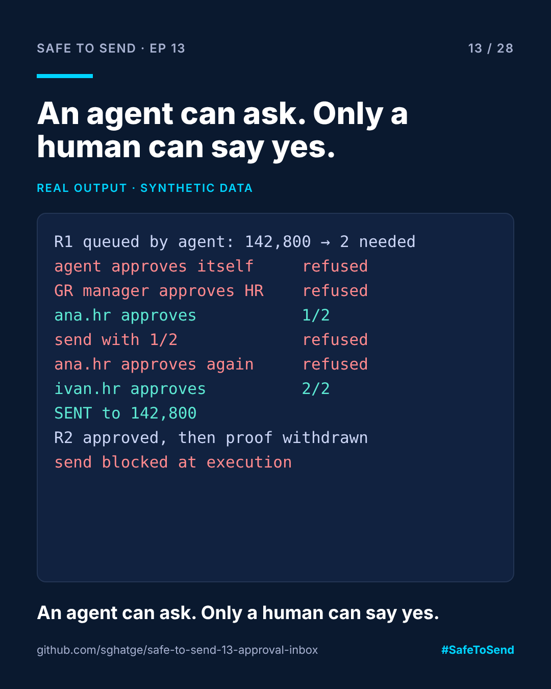

# safe-to-send-13 · Approval Inbox



**Safe to Send · Episode 13** — a 28-day learn-in-public series on governing AI in CRM operations.

> An agent can ask. Only a human can say yes, and the yes expires if the facts change.

## The real-world scenario

An agent prepares a 142,800-recipient send and asks for approval. Who can approve it? Can the agent approve itself through another tool? Can the Greek manager approve a Croatian send? And if the proof is withdrawn after approval but before the send, does the old "yes" still count?

## Run it

```bash
python approval_inbox.py
```

## Real example output

```
  ok      R1: queued by agent:bf-helper, needs 2 approver(s)
  REFUSED agent:bf-helper cannot approve their own request
  REFUSED eleni.gr has no approval rights for HR
  ok      R1: approved by ana.hr (1/2)
  REFUSED R1: 1/2 approvals
  REFUSED ana.hr already approved R1
  ok      R1: approved by ivan.hr (2/2)
  ok      R1: SENT to 142,800 recipients
  ok      R2: queued by agent:bf-helper, needs 1 approver(s)
  ok      R2: approved by eleni.gr (1/1)
  REFUSED R2: proof was withdrawn after approval, send blocked
```

## The rules, in plain words

| Rule | Why |
|---|---|
| No self-approval | Separation of duties, for agents and people alike |
| Agents can never approve | Approval is not exposed as an agent capability |
| Market-scoped roles | The person approving knows that market |
| Two different people above 100,000 recipients | One distracted click shouldn't reach that many people |
| Re-check at execution | An approval is for the delivery as it was, not as it is now |

The last row is the one most approval flows miss.

MIT · [Sangram Ghatge](https://www.linkedin.com/in/sangram-g-2369705b) · #SafeToSend
